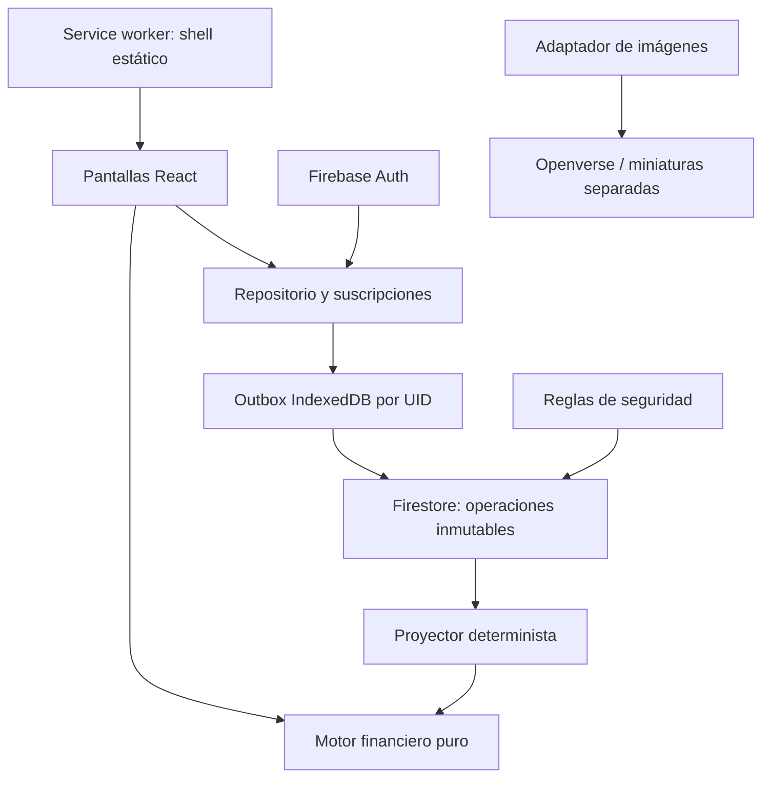

# Arquitectura propuesta

## Contexto

El repositorio está inicializado en `main` y el commit inicial está publicado.
La Fase 1 fue aceptada provisionalmente y la Fase 2 autorizada el 2026-11-22.
La base React/TypeScript/Vite y el shell PWA están implementados; Firebase Auth
y Firestore funcionan exclusivamente en emuladores para Fase 4. Ver [informe de Fase 2](phase2/REPORT.md).
No hay backend propio, Functions ni Storage. Fase 5 conecta el registro financiero
v2 con React y emuladores; [implementación y límites](phase5/REPORT.md). El outbox
y la sincronización distribuida del diagrama siguen siendo propuestas de Fase 6.

## Implementación de acceso · Fase 4

`features/access` conserva el diseño y usa un contexto de sesión mínimo.
`repositories/access` separa Auth, viajes, invitaciones y contratos persistidos;
el dominio financiero permanece intacto. Auth usa persistencia local del SDK;
Firestore conserva únicamente memoria. Suscripciones ignoran snapshots sin
confirmación del servidor y vistas privadas se desmontan al cambiar UID.

Crear viaje usa transacción SDK online con cuatro documentos, incluido budget
v2. El join usa `documents:commit` REST con ID token Auth de un cliente normal:
tres writes con máscara FieldPath/transforms y precondiciones, sin leer trip ni
usar Admin SDK. Así no se agrega un batch administrativo a una cola offline.
La autorización permanece en Firestore y no depende de la interfaz ni del REST.
Metadatos, invitaciones y revocación usan transacciones online del SDK.

Las reglas se validan con clientes ordinarios, getAfter y la carrera de la última
plaza. Cierre/reasignación y fotos continúan denegados. Fase 5 habilita únicamente
create financiero v2 validado; update/delete siguen denegados. [Informe y límites comprobados](phase4/REPORT.md).
El diagrama del contexto incluye módulos de fases futuras: outbox, adjuntos y
sincronización distribuida todavía no existen.

## Límites y módulos previstos

La Fase 3 implementa `src/domain/` con esquemas Zod, DTO financieros versionados,
adaptación a BigInt y cálculos puros. Recibe snapshots/revisiones con estado de
completitud explícito o proyecta eventos localmente, verificando ancestros y
cabezas. No implementa transporte, pares merge ni decide ganadores de conflictos.
Todos los resultados se derivan de la misma selección efectiva y propagan
provisionalidad. Vitest separa proyecto Node de UI y TypeScript comprueba el
dominio sin lib DOM ni tipos React. Detalle en [informe de Fase 3](phase3/REPORT.md).

| Módulo futuro | Responsabilidad | No debe hacer |
| --- | --- | --- |
| `domain/` | Contratos Zod, dinero, reparto, saldos, presupuesto, validación | Importar React/Firebase o usar reloj implícito |
| `sync/` | Outbox, proyección DAG, idempotencia, conflictos y completitud | Sobrescribir propuestas ni calcular dinero con floats |
| `repositories/` | Auth, consultas Firestore, suscripciones, admisión y administración | Mantener otro saldo independiente |
| `attachments/` | Compresión, metadata, búsqueda, atribución y reintento separado | Bloquear la operación monetaria |
| `features/` | Viajes, gastos, personas, presupuesto, balance, actividad | Definir esquemas diferentes para el mismo evento |
| `app/` | Routing, contexto de sesión, errores y tokens CSS | Tratar caché como autorización del servidor |

Usar estado React para formularios y navegación; suscripciones para datos. Evitar TanStack Query mientras no aporte una necesidad concreta. Zod valida fronteras; reglas validan escrituras hostiles; pruebas verifican semántica. No se instala nada durante Fase 0.

## Fuente financiera: registro de eventos, proyecciones locales

Se concreta el modelo preliminar con **una colección `events` por viaje** para cambios financieros. Gastos, abonos, presupuesto y resoluciones son proyecciones del mismo registro. No se escriben simultáneamente documentos mutables `expenses`, `settlements`, `dailyBudgets` o `conflicts` como otras fuentes de verdad. Esta elección evita una sincronización dual y no depende de resolución last-write-wins.

Cada entidad tiene un grafo acíclico de revisiones: crear no tiene padres, editar tiene uno y resolver tiene dos. Dos cabezas incompatibles son conflicto. La revisión es el ID de operación, nunca solo un contador. Un evento posterior a una resolución puede reabrir el conflicto si aparece una rama que esa resolución no conocía. La hora local sirve para mostrar; no decide ganadores.

El proyector calcula hechos contables efectivos a partir del grafo completo disponible. Excluye entidades en conflicto del subtotal validado y marca balances/presupuestos como provisionales. Puede mostrar propuestas comparadas; no oculta importes pendientes. El historial conserva todas las ramas y el antes/después. El diseño detallado está en [OFFLINE_SYNC](OFFLINE_SYNC.md).

## Administración central, solo online

Los metadatos de viaje y los accesos usan escrituras atómicas y revisiones comprobadas. En el MVP se propone fijar fechas, zona y moneda al crear el viaje; así no se reasignan días contables por un cambio posterior. Cambiar título/destino no modifica dinero. Permitir corregir fechas después será una decisión de producto y requerirá revisar presupuesto y agrupaciones; no se añade un bloqueo dependiente de consultar toda la colección de eventos.

El invitado no puede leer `trips/{id}` antes de pertenecer al viaje. Por ello **no se diseña un join que lea ese documento en una transacción cliente**. Se usa una escritura ciega atómica con perfil de miembro y adición del propio UID al mapa acotado de accesos. Las reglas inspeccionan estado previo/posterior y la invitación. El cliente recibe datos privados únicamente después del commit. Ver [SECURITY_RULES](SECURITY_RULES.md).

La lista activa admite hasta 10 UIDs vinculados a personas distintas. Las personas históricas no se borran al revocar acceso. La sustitución del UID histórico requiere un procedimiento seguro pendiente; en Fase 4 se mantiene denegada. El nombre no permite reclamar esa identidad.

## Confianza y garantías

Reglas y cliente no son equivalentes: se rechazan en servidor autores falsos, acceso indebido, mutación de eventos, totales incoherentes y payloads fuera de límites. El servidor no puede certificar que una compra ocurrió, que un invitado es una persona física distinta o que una licencia publicada describe correctamente la imagen.

Las reglas no recorren todo un DAG ni descubren todas sus cabezas: verifican padres directos y contratos locales. La aplicación deriva conflictos a partir del conjunto de eventos; ningún campo `resolved: true` enviado por un cliente elimina otra rama. La seguridad protege el registro; la convergencia del proyector requiere pruebas específicas. El historial es inmutable frente a clientes ordinarios, no frente a un administrador con credenciales privilegiadas.

## PWA y operación

Service worker para HTML/JS/CSS/iconos con precache explícito, fallback de navegación y actualización ofrecida cuando no arriesgue cambios pendientes. Firestore se ocupa de datos; no se cachean respuestas Auth/Firestore mediante Workbox. Caché persistente multitab en dispositivo confiable, con fallback visible si IndexedDB no funciona. La cola propia es pequeña y almacena estado de entrega/rechazos; no duplica una base de saldos.

Hosting estático con HTTPS y rewrites SPA. Para Raspberry: servir build estático con HTTPS, fallback de rutas, políticas de caché, origen autorizado de Auth y CORS comprobados. Cambiar origen no migra el UID anónimo ni IndexedDB; avisar y preparar reinvitación antes de migrar. Firestore sigue en nube. La indisponibilidad de Raspberry afecta nuevas cargas del frontend, no mueve Firestore al equipo local.

## Alternativas y condiciones de revisión

- CRUD mutable con contador de revisión: más corto, pero puede rechazar una edición offline sin preservar su propuesta. Descartado como fuente financiera única.
- Registro inmutable más snapshot autoritativo transaccional: posible, pero añade reconciliación y dos estados persistidos. No se necesita para este tamaño inicial.
- Solo registro sin outbox: no conserva suficientemente errores definitivos tras rechazo de reglas. Se mantiene outbox durable hasta confirmación o descarte explícito.
- Backend confiable: facilitaría límites de abuso y snapshots verificados, pero cambia operación y alcance. No se incorpora silenciosamente si las reglas propuestas no alcanzan los criterios; se revisa la arquitectura.

La Fase 4 debe demostrar la admisión sin lecturas previas; Fases 3/6 deben demostrar proyección y reconexión. No afirmar que las garantías están implementadas por disponer de estos documentos.

## Adjuntos independientes (Fase 7)

El módulo src/attachments implementa procesamiento local, fuente Openverse,
IndexedDB y transporte create-only separado del financiero. Guarda primero el
evento durable y después la miniatura. Espera confirmación financiera para enviarla;
una respuesta de imagen nunca escribe otra revisión de gasto. Los bytes y créditos
se solicitan por ID/viewport y permanecen fuera del motor, suscripciones de eventos
y caché pública del SW. Reutiliza contratos, servicios por UID y leases existentes.
Detalle y fronteras de validación: [Fase 7](phase7/REPORT.md).
