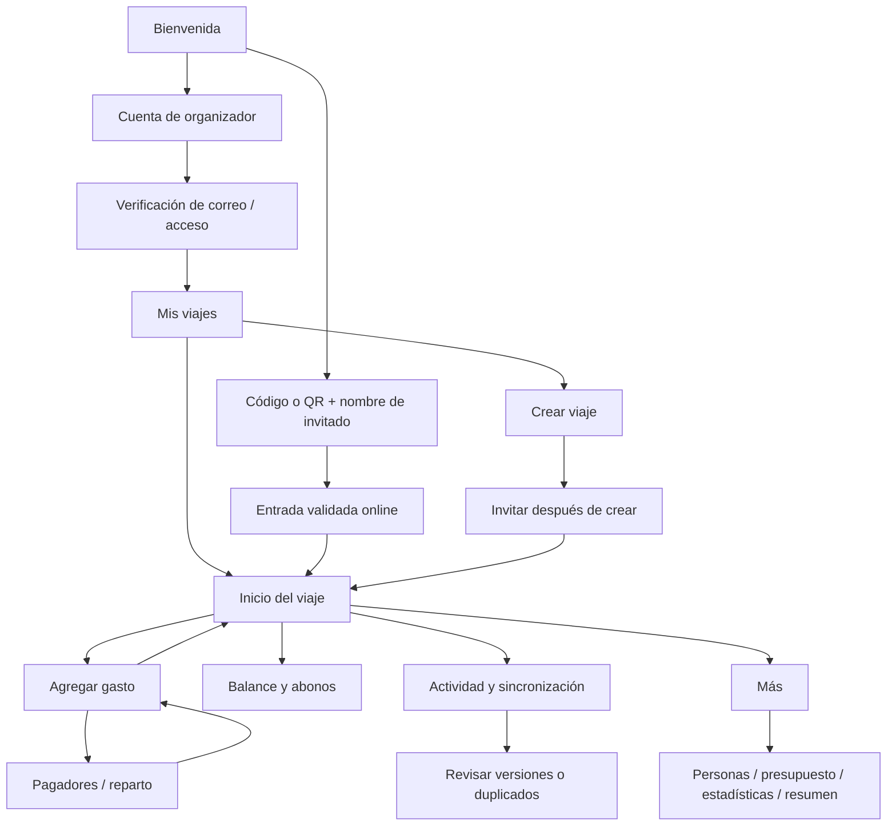

# Flujos de usuario

Versión de revisión Fase 1. Referencia de alcance: [diferencias y decisiones](SCOPE_RECONCILIATION.md). El [prototipo](../../design/prototype/index.html) representa interacciones locales; no valida backend.

## Arquitectura de información

La navegación inferior contiene Inicio, Balance y Actividad. No añadir pestaña por cada función. «Más opciones del viaje» se encuentra en cabecera con nombre accesible. En escritorio esos destinos secundarios están en la barra lateral; no cambia su comportamiento.

## F-01. Organizador nuevo

Bienvenida → Crear mi cuenta → nombre, correo, contraseña → verificar correo → Mis viajes. Recuperación accesible desde login. Errores inline, conservar correo/nombre; contraseña nunca se copia a historial ni queda en rutas. Sin conexión, registro/login/recuperación requieren esperar a tener internet. El prototipo usa valores ficticios y no envía correo.

D-03 continúa propuesta: la vista sirve para evaluar correo/contraseña, no ratifica proveedor final. Si se elige Google, sustituir este recorrido antes de producción.

## F-02. Invitado sin cuenta

Bienvenida → Unirme → pegar enlace/código completo o escanear QR → indicar nombre → aceptar advertencia de conservación local de acceso → Unirme → Inicio del viaje tras confirmación online. No pedir correo/contraseña ni mostrar personas/título privados antes de pertenecer.

QR denegado: mostrar pegar código sin segundo modal. Código expirado/revocado: pedir invitación nueva. Diez lugares: explicar grupo completo. Sin internet: no intentar incorporación offline. Cambiar dispositivo o limpiar navegador: reinvitación; no recuperar identidad por escribir el mismo nombre.

## F-03. Crear viaje e invitar

Mis viajes → Crear viaje → nombre, destino opcional, fechas → moneda y zona → presupuesto opcional → organizador como primera persona → portada opcional → Crear → Personas e invitación. El viaje queda esperando hasta llegar a dos personas. No añadir nueve campos de nombres ficticios ni prometer alta sin autenticación.

Fechas inválidas y fin anterior al inicio se rechazan. Mostrar antes de confirmar que fechas/zona/moneda quedan fijas según la propuesta vigente. No obligar a definir presupuesto ni imagen.

## F-04. Captura rápida, recorrido dominante

Inicio → Agregar gasto → Concepto → Importe → Guardar. Sin pasos intermedios obligatorios. Defaults visibles: paga quien registra, se reparte igual entre activos, categoría Otro, fecha/hora del viaje. El resumen muestra «Tú»/personas y «Tu parte» antes de guardar.

Son dos entradas de texto y dos acciones de botón desde Inicio, sin contar pulsaciones del teclado. La categoría se puede dejar por defecto. La velocidad real debe evaluarse con usuarios; no se afirma una duración medida.

Importe inválido: error local y foco al resumen/campo, sin limpiar formulario. Gasto offline: confirmación local y contador pendiente; sin promesa de envío con PWA cerrada. Fallo de almacenamiento: no mostrar éxito ni abandonar formulario.

## F-05. Múltiples pagadores

Gasto → Quién pagó → seleccionar uno o varios → importes aportados → total aportado frente al total del gasto → Aplicar → volver al mismo borrador. Un pagador único cubre automáticamente el total y su importe no es un segundo total editable. Con varios, cada aporte debe ser positivo y la suma exacta.

No confundir pagar con participar: cambiar pagadores no cambia las cuotas. Payer inválido bloquea aplicar/guardar; «Faltan $…» o «Sobran $…» explica la diferencia.

## F-06. Repartir y excluir

Gasto → Cómo dividimos → tres modos: Igual, Porcentajes, Importes → incluir/excluir personas → revisar total asignado → Aplicar → volver al borrador.

Igual: cuotas y redondeo exactos. Porcentajes: aceptar centésimas, 100% exacto; 99,99%/100,01% no se aproximan. Importes: asignar directamente unidades menores; no convertir a porcentaje. Excluido muestra 0 y no recibe sobrantes. No permitir excluir a todos. Cambiar importe del gasto obliga a revisar un reparto personalizado que deje de cuadrar; no corregir silenciosamente.

Dos, tres o diez personas usan una lista vertical; no carrusel de avatares para elegir cuotas. Los inputs tienen nombre completo accesible.

## F-07. Editar y auditoría

Movimiento → detalle → quién pagó/cuotas/nota → Historial → Editar → formulario precargado → Guardar cambios → nueva entrada en historial. Eliminar → confirmación explícita → exclusión financiera, entrada aún consultable → Restaurar como nueva operación.

Salir del borrador: conservar borrador o seguir editando. En la aplicación futura debe ser durable cuando se haya confirmado localmente; en el prototipo se advierte que recargar lo pierde. No usar un toast efímero como única forma de acceder a auditoría.

## F-08. Balance y abonos

Balance → ver pagado/cuota/saldo por persona → pagos sugeridos → Registrar en una sugerencia (origen/destino/importe precargados) o Registrar abono → confirmar datos → historial. No ejecutar transferencia bancaria. El costo del viaje no cambia.

Abono superior a sugerencia: advertir saldo invertido/adelanto y permitir confirmar si ocurrió. Mismo origen/destino o importe no positivo: rechazar. Con datos provisionales, sugerencias son orientativas y están rotuladas.

## F-09. Presupuesto

Más → Presupuesto → disponible total y tabla diaria (Inicial / Gastado / Propuesta) → Ajustar por organizador → total opcional y cupos por día → guardar → tabla recalculada. Campo diario vacío significa automático; importe explícito, incluso cero, significa fijo.

Ejemplo: 400.000/4 días, gasto hoy 250.000: mañana y otros dos días quedan 50.000. Fijar último día 80.000 deja 35.000 para cada uno de los otros dos. Si un gasto posterior causa déficit, mantener reserva, mostrar automáticos en cero y explicar falta de financiación. No bloquear gasto real.

Participante consulta, pero no cambia presupuestos. El diseño no presenta una asignación automática reconstruida como si fuera un presupuesto histórico inmutable.

## F-10. Red y actividad

Estado en cabecera → Actividad → pendientes monetarios y adjuntos separados → motivo del error y acción útil. «Sincronizar ahora» complementa reintento automático futuro; offline queda deshabilitado con explicación. Error de permiso no provoca bucle indefinido. Propuesta local puede copiarse.

No cubrir toda la pantalla con un banner rojo por falta de red: se permite la captura local. Datos nunca descargados/incompletos tienen estado diferente, para no mostrar cero como total definitivo.

## F-11. Ediciones simultáneas

Actividad → conflicto → comparar concepto, importe, pagador, reparto, nota, autor/hora de ambas versiones → seleccionar una o crear versión corregida → confirmar resolución → historial conserva ambas → saldo deja de ser provisional cuando se hayan resuelto todas las ramas conocidas.

Ninguna versión se preselecciona por hora. Si llega otra edición después, el conflicto puede reaparecer. El prototipo ilustra dos versiones; reconciliación real de DAG y más de dos cabezas sigue siendo trabajo de Fase 6.

## F-12. Posibles duplicados

Actividad → comparar dos cafés, con monto/día/pagadores/proximidad → Son distintos (ambos siguen contando) o Unificar → confirmar superviviente/importe final → único importe efectivo e historial completo. La muestra conserva el primer café por $12.000 y oculta lógicamente el segundo.

Candidatos no se eliminan por nombre. Mostrar que ambos cuentan antes de la decisión. No prometer «deshacer» como toggle; una edición tardía sobre gastos unificados requiere revisión del grupo.

## F-13. Finalizar y consultar

Más → Resumen → costo, presupuesto, saldos, deudas → comprobar conexión, completitud y ausencia de pendientes locales/conflictos → Finalizar → confirmación con advertencia de otros dispositivos → resumen cerrado → Mis viajes/historial → consulta de movimientos.

Saldo cero no es requisito: deudas quedan visibles. No reabrir ni habilitar escritura en cerrados mientras D-13 siga pendiente. Una incidencia tardía se presenta como provisional, con explicación de la limitación.

## Fixture único para revisar cifras

Viaje de ejemplo 21–24 nov, COP 400.000, Ana/Bruno/Carla. Almuerzo 96.000 paga Ana; mercado 84.000 pagan Ana 34.000 y Bruno 50.000; ambos se reparten entre tres. Gasolina 70.000 paga Carla y consumen Ana/Bruno. Costo 250.000. Abono previo Bruno→Ana 15.000. Saldos: Ana +20.000, Bruno −30.000, Carla +10.000. No usar otros totales decorativos que contradigan estas cifras en pantallas del mismo recorrido.

## Refinamiento posterior a la revisión

Captura mantiene dos entradas principales: categoría/fecha/nota se despliegan cuando se necesitan y la elección de imagen separa Cámara, Galería y Stock. El presupuesto expone cupo y exceso/ahorro provisional de hoy, con redistribución solo en detalle. Actividad lista las operaciones pendientes concretas y conserva las creadas durante un envío para un siguiente intento. Se registran ambos pagos sugeridos para saldar el fixture: Bruno→Ana $20.000 y Bruno→Carla $10.000. Ver [revisión de ajustes](VISUAL_ADJUSTMENTS.md).
